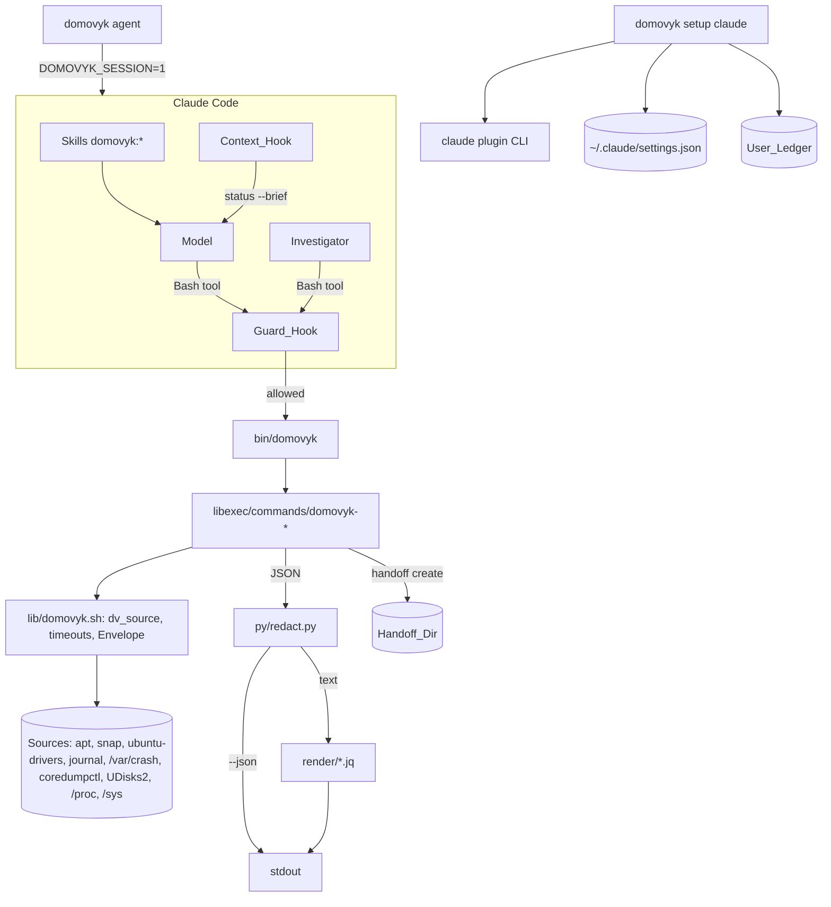
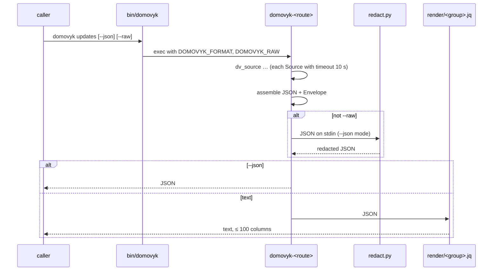

# Design Document: domovyk-core

## Overview

Phase 1 of `DESIGN.md`. A read-tier CLI collects facts about the Host and prints them as text, or as JSON with a fixed envelope. Six skills teach an agent how to use it. A Claude Code plugin delivers the skills, guards the Bash tool and gives an Agent_Session its starting context. Every change the agent proposes becomes a Handoff_Script that the owner reads and runs. Phase 1 contains no privileged code.

One rule shapes the CLI: **every Read_Command builds JSON first.** Redaction runs on that JSON. The text view is rendered from the redacted JSON by a `jq` template. So text and JSON never disagree, and redaction happens in exactly one place.

### Terms introduced by this design

- **Envelope**: the keys every Fact_Output JSON document carries (`schema`, `generated`, `host`, `unavailable`).
- **Renderer**: the `jq` program that turns a Command's JSON into its text view (`libexec/render/<group>.jq`).
- **Facts_Cache**: `~/.cache/domovyk/facts/<route>.json`. `status` and `doctor` reuse a Read_Command's JSON from here when it is under 60 seconds old.
- **Check**: one `jq` program under `libexec/checks/` that reads the collected facts and emits zero or more Findings.
- **Fake_Bin**: `test/unit/fixtures/bin/`, scripts that stand in for Sources in unit tests by replaying recorded output.

### Departures from DESIGN.md

| DESIGN.md | This spec | Reason |
|---|---|---|
| System-tier actions through the pkexec Helper | None. Every change is a Handoff_Script, and the Guard_Hook also denies `pkexec`. | Phase 1 scope (DESIGN.md decision 5). The Helper is phase 2. |
| Skills in `/usr/share/domovyk/agents/skills` | Canonical copy in `/usr/share/domovyk/claude/plugins/domovyk/skills`. `agents/skills` is a symlink to it. | Claude Code rejects plugin component paths that resolve outside the plugin root. |
| SMART through `smartctl` (a Recommends) | SMART through UDisks2 over D-Bus | `smartctl` needs root (DESIGN.md decision 6). |
| Guard_Hook as a pattern list | A shell tokenizer in Python (`shlex` with `punctuation_chars`) that recurses into `bash -c`, `sh -c`, `$(…)` and backticks | Patterns miss `env sudo`, `xargs sudo` and `bash -c 'sudo …'`. |

## Architecture



### Read_Command pipeline



## Components and Interfaces

### File layout (installed)

| Path | Contents |
|---|---|
| `/usr/bin/domovyk` | dispatcher |
| `/usr/libexec/domovyk/commands/domovyk-<route>` | one executable per Command |
| `/usr/libexec/domovyk/lib/domovyk.sh` | shared library |
| `/usr/libexec/domovyk/render/<group>.jq` | Renderers |
| `/usr/libexec/domovyk/checks/<id>.jq` | doctor Checks |
| `/usr/libexec/domovyk/py/{redact,apport_crash,guard}.py` | Python helpers |
| `/usr/libexec/domovyk/hooks/{guard,context}` | hook entry points |
| `/usr/libexec/domovyk/unsetup` | self-contained Unsetup (copied to the user's state folder by Setup) |
| `/usr/share/domovyk/redact.tsv` | Redaction_Rules |
| `/usr/share/domovyk/claude/` | Marketplace and Plugin |
| `/usr/share/domovyk/agents/skills` | symlink to the Plugin's `skills/` |
| `/usr/share/domovyk/workspace/CLAUDE.md` | Workspace template |
| `/usr/share/doc/domovyk/` | README, changelog, copyright |

The dispatcher sets `DOMOVYK_ROOT` (default `/usr`). Tests set it to the working tree, where the same layout exists under `bin/`, `libexec/` and `share/`. In the working tree, `libexec/` maps to `/usr/libexec/domovyk/` and `share/` to `/usr/share/domovyk/`.

### Dispatcher (`bin/domovyk`)

```
domovyk <group> [<action>] [options] [args]
domovyk commands [--json]
domovyk --version
options common to Read_Commands: --json  --raw  --help
```

- **Route resolution:** given words `a b …`, try `domovyk-a-b`, then `domovyk-a`. The remaining words are arguments. `domovyk crash` without an action runs `domovyk-crash-list`, through a default-action table in the dispatcher.
- **Unknown route:** exit 2. Print `unknown command: <words>` and up to 3 closest routes by edit distance.
- **Help:** `--help` anywhere prints the target's Command_Metadata (or the group's Commands) and never executes the Command.
- **Environment passed to Commands:** `DOMOVYK_ROOT`, `DOMOVYK_FORMAT=text|json`, `DOMOVYK_RAW=0|1`, `DOMOVYK_TIMEOUT` (default 10).
- **Release check:** reads `/etc/os-release`. A `VERSION_CODENAME` other than `noble` or `resolute` prints one warning to stderr (1.5).

### Command_Metadata

The first comment block of each Command:

```bash
#!/bin/bash
# domovyk:summary=Show pending updates across apt, snap, flatpak and firmware
# domovyk:tier=read
# domovyk:args=[--json] [--raw]
# domovyk:examples=domovyk updates | domovyk updates --json
```

`domovyk commands --json` parses these lines with `sed` and emits `{route, tier, summary, args, examples}`. Phase 1 Commands and their Tiers:

| Route | Tier | Requirement |
|---|---|---|
| `commands` | read | 2 |
| `version` | read | 2 |
| `status` | read | 6 |
| `doctor` | read | 7 |
| `updates` | read | 8 |
| `drivers` | read | 9 |
| `crash list` · `crash info` · `crash backtrace` | read | 10 |
| `logs` | read | 11 |
| `perf` | read | 12 |
| `disk` · `disk usage` | read | 13 |
| `services` · `services status` | read | 14 |
| `hw` | read | 14 |
| `handoff list` · `handoff show` | read | 15 |
| `handoff create` | user | 15 |
| `setup claude` · `unsetup` | user | 20 |
| `agent` · `agent prompt` · `agent crash` | user | 21 |

`crash backtrace` stays in the read tier. It writes only a temporary directory, which it deletes (10.4, 10.5), and it opens the network only with `--symbols` (3.2).

### Shared library (`libexec/lib/domovyk.sh`)

| Function | Contract |
|---|---|
| `dv_init <schema>` | Sets the schema id. Starts the Envelope and the `unavailable` list. Installs an EXIT trap that removes `DV_TMPDIRS`. |
| `dv_have <cmd> <apt-package>` | Returns 0 if `<cmd>` is on PATH. Otherwise records `{source:<cmd>, reason:"missing", package:<apt-package>}` and returns 1. |
| `dv_source <name> [--timeout s] -- <argv…>` | Runs argv with `timeout --kill-after=2 ${s:-$DOMOVYK_TIMEOUT}`, stdout to a temp file, stderr to a second one. Exit 124 or 137 records `timeout`. A permission error (`EACCES` text, or exit 77 from our own wrappers) records `permission`. Prints the temp file path on success. |
| `dv_readable <path> <name>` | Records `permission` for an unreadable path and returns 1. |
| `dv_mktemp_dir` | `mktemp -d` with mode 0700, registered in `DV_TMPDIRS`. |
| `dv_emit <json-file>` | Merges the Envelope into the JSON. Pipes it through `redact.py --json` unless `DOMOVYK_RAW=1`. Prints it with `--json`, or renders it with `render/<group>.jq`. |
| `dv_die <step> <message>` | Prints `domovyk <route>: <step>: <message>` to stderr and exits 1 (4.5). |
| `dv_usage <message>` | Prints usage and exits 2. |
| `dv_cache_get <route>` / `dv_cache_put <route> <file>` | Facts_Cache, valid for 60 s, mode 0600. Stores redacted JSON only. |

### Envelope and schemas (4.3, 4.6)

Every document:

```json
{
  "schema": "domovyk.updates.v1",
  "generated": "2026-11-15T21:04:05Z",
  "host": {"codename": "resolute", "release": "26.04.1", "kernel": "7.0.0-43-generic"},
  "unavailable": [{"source": "fwupdmgr", "reason": "missing", "package": "fwupd"}]
}
```

The hostname, machine ID and serial numbers are omitted on purpose. Top-level keys per schema, on top of the Envelope:

| Schema | Keys |
|---|---|
| `domovyk.commands.v1` | `commands` |
| `domovyk.version.v1` | `version`, `root` |
| `domovyk.status.v1` | `reboot`, `failed_units`, `updates`, `crashes_7d`, `fullest_filesystem`, `findings` |
| `domovyk.doctor.v1` | `findings` |
| `domovyk.updates.v1` | `apt`, `snap`, `flatpak`, `firmware`, `reboot`, `sources`, `unattended` |
| `domovyk.drivers.v1` | `devices`, `candidates`, `dkms`, `secure_boot`, `firmware_devices` |
| `domovyk.crash-list.v1` | `crashes` |
| `domovyk.crash-info.v1` | `crash`, `recurrence`, `oom`, `apt_history` |
| `domovyk.crash-backtrace.v1` | `crash_id`, `signal`, `threads`, `libraries`, `symbols` |
| `domovyk.logs.v1` | `boot`, `groups`, `oom_kills`, `kernel`, `suspend`, `journal` |
| `domovyk.logs-unit.v1` | `unit`, `entries` |
| `domovyk.perf.v1` | `load`, `cpu_count`, `memory`, `swap`, `zram`, `pressure`, `top_cpu`, `top_memory`, `thermal`, `throttling`, `power_profile`, `boot`, `sample` |
| `domovyk.disk.v1` | `filesystems`, `reclaimable`, `drives`, `fstrim_timer` |
| `domovyk.disk-usage.v1` | `path`, `entries`, `incomplete` |
| `domovyk.services.v1` | `failed_system`, `failed_user` |
| `domovyk.services-status.v1` | `unit` |
| `domovyk.hw.v1` | `cpu`, `gpus`, `memory_bytes`, `battery`, `firmware`, `machine` |
| `domovyk.handoff.v1` | `scripts` |

`perf.boot` and `perf.sample` are `null` unless `--boot` or `--sample` is given. `hw.battery` is `null` when there is no battery (14.4). Field-level shapes are documented in `test/unit/schemas/<schema>.jq`: each file is a `jq` predicate that a unit test runs against fixture output.

### Facts per group: Sources

| Group | Sources (all as the invoking user) | Notes |
|---|---|---|
| updates | `apt-get -s -o Debug::NoLocking=1 dist-upgrade`, `apt-cache policy <pkg>` for phasing, `/var/lib/apt/lists` mtimes, `apt-mark showhold`, `dpkg-query -W -f '${Status}'`, `/etc/apt/sources.list.d/*`, `snap refresh --list`, `flatpak remote-ls --updates`, `fwupdmgr get-updates --json --no-unreported-check`, `/run/reboot-required{,.pkgs}`, `/var/log/unattended-upgrades/unattended-upgrades.log` | Never `apt update` (8.5). Security means the candidate's origin suite ends in `-security`. Phasing comes from `apt-cache policy`'s `(phased N%)`. |
| drivers | `/sys/bus/pci/devices/*/{vendor,device,driver}`, `lspci -mm -nn`, `lsusb`, `ubuntu-drivers list`, `ubuntu-drivers list --recommended`, `dkms status`, `/var/lib/dkms/*/*/build/make.log`, `mokutil --sb-state`, `mokutil --list-new`, `fwupdmgr get-devices --json` | `ubuntu-drivers` runs without root in list mode. |
| crash | `/var/crash/*.crash` through `py/apport_crash.py`, `coredumpctl list --json=short`, `coredumpctl info`, `journalctl -k --grep 'Out of memory'`, `/var/log/apt/history.log` | See Crash_Record below. |
| logs | `journalctl -b <n> -p err -o json`, `journalctl --list-boots -o json`, `journalctl --disk-usage`, `journalctl -k -b <n> -o json` | Reports access to the system journal as `permission` when only user entries come back (11.5). |
| perf | `/proc/loadavg`, `/proc/meminfo`, `/proc/swaps`, `/sys/block/zram*`, `/proc/pressure/{cpu,memory,io}`, `ps -eo pid,comm,%cpu,rss --sort`, `/sys/class/thermal/thermal_zone*`, `journalctl -k --grep 'throttled'`, `powerprofilesctl get`, `systemd-analyze`, `systemd-analyze blame`, `/proc/stat` and `/proc/diskstats` sampled twice | |
| disk | `findmnt -J -o TARGET,SOURCE,FSTYPE,SIZE,USED,AVAIL`, `df -i --output`, `du -sb` with `timeout`, `snap list --all`, `dpkg-query` for kernels, `journalctl --disk-usage`, `~/.local/share/Trash`, `docker system df --format json` (only if the user can reach the socket), `busctl --system --json=short` against `org.freedesktop.UDisks2` (`Drive.Ata.SmartFailing`, `NVMe.Controller.SmartCriticalWarning`), `systemctl is-enabled fstrim.timer` | `du` per category stops at 25 s and marks results `incomplete` (13.6). |
| services | `systemctl --failed -o json`, `systemctl --user --failed -o json`, `systemctl show <unit> -p …`, `journalctl -u <unit> -n N -o json` | |
| hw | `/proc/cpuinfo`, `lspci -mm -nn -k` (VGA/3D), `/sys/class/power_supply/BAT*/{energy,charge}_{full,full_design}`, `/sys/class/dmi/id/{bios_vendor,bios_version,sys_vendor,product_name}` | Excludes serial and UUID files. |

### Crash_Record (10)

- **Identifier:** `c<epoch>-<pid>`, from the crash time (whole seconds, UTC) and the PID. Stable across runs, and the same for both Sources.
- **Merge:** an apport record and a coredump record merge when the PIDs are equal and the times differ by ≤ 5 s. `sources` then lists both (10.2).
- **apport:** `py/apport_crash.py summary <file>` reads the RFC 822-style `.crash` file. It extracts `ExecutablePath`, `Package`, `ProcCmdline`, `Signal`, `Date`, `ProcStatus:Pid`, `ProcStatus:Uid` and whether a `CoreDump` is present. It never decodes `CoreDump` (10.6). Files the user cannot read are listed with `readable:false` and only the name and time from the filename and mtime.
- **coredumpctl:** `coredumpctl list --json=short --no-pager` gives PID, UID, signal, exe and timestamp, and whether the core is present.
- **Backtrace (10.4–10.8):**
  1. `dir=$(dv_mktemp_dir)`, with an EXIT/INT/TERM trap that runs `rm -rf -- "$dir"`.
  2. For apport, `apport-unpack <file> "$dir/u"` and the core is `$dir/u/CoreDump`. For coredump, `coredumpctl dump <pid> --output="$dir/core"`.
  3. Run `gdb -q -nx -batch -ex 'set debuginfod enabled <on|off>' -ex 'set pagination off' -ex 'thread apply all bt' -ex 'info sharedlibrary' <exe> <core>`, with `DEBUGINFOD_URLS` from `/etc/debuginfod/*.urls` only under `--symbols`.
  4. Parse the gdb output into threads and frames. A frame with `??` has `function: null` and keeps `address` and `library` (10.8).
  5. The trap deletes `$dir`. The output never includes gdb's `print` or `x` output, because the command list above has none.

### Redactor (5)

`py/redact.py [--json] [--rules <tsv>]`. The rules file has three tab-separated columns: `name`, a Python `re` pattern, and flags (`i` or empty). Loading compiles every rule. A missing file or a `re.error` exits 1 with `redact: <rule>: <error>` (5.6). In JSON mode it walks the document and redacts every string value and every object key. In text mode it redacts each line. The replacement is `[redacted:<name>]`. Rules apply in file order, and rule names never match any rule, so the output is idempotent.

Initial rules (5.5):

| name | pattern (abridged) |
|---|---|
| `private-key` | `-----BEGIN [A-Z ]*PRIVATE KEY-----[\s\S]*?-----END [A-Z ]*PRIVATE KEY-----` |
| `bearer` | `(?i)\bbearer\s+[A-Za-z0-9._~+/-]{16,}=*` |
| `url-password` | `(?<=://)[^/\s:@]+:[^/\s@]+(?=@)` |
| `assignment` | `(?i)\b(password\|passwd\|secret\|token\|api[_-]?key)\s*[=:]\s*\S+` |
| `wifi-psk` | `(?i)\b(psk\|wpa-psk)\s*[=:]\s*\S+` |
| `aws-key-id` | `\b(AKIA\|ASIA)[A-Z0-9]{16}\b` |
| `github-token` | `\bgh[pousr]_[A-Za-z0-9]{36,}\b` |
| `anthropic-key` | `\bsk-ant-[A-Za-z0-9_-]{20,}` |
| `openai-key` | `\bsk-(proj-)?[A-Za-z0-9_-]{20,}` |
| `email` | `\b[A-Za-z0-9._%+-]+@[A-Za-z0-9.-]+\.[A-Za-z]{2,}\b` |

### Status and doctor (6, 7)

`doctor` collects facts from `updates`, `drivers`, `crash list`, `logs`, `disk` and `services`. It runs them in parallel as background jobs (`--json`, redacted) or takes them from the Facts_Cache, combines them into `{updates:…, drivers:…, …}`, and pipes that into each Check:

| Check id | Severity | Fires when | Suggestion |
|---|---|---|---|
| `reboot-pending` | warning | `/run/reboot-required` older than 3 days | `domovyk updates`, then a reboot |
| `failed-units` | warning | any failed system or user unit | `domovyk services` |
| `fs-full` | critical | any filesystem's blocks over 90 % | `domovyk disk` |
| `inodes-full` | critical | any filesystem's inodes over 90 % | `domovyk disk` |
| `smart-failing` | critical | UDisks2 reports a failing drive or a critical NVMe warning | `domovyk disk`, then back up now |
| `driver-available` | info | an `ubuntu-drivers` candidate is not installed | `domovyk drivers` |
| `packages-broken` | critical | a package not in `ii` or `hi` state | `domovyk handoff create` for `dpkg --configure -a` |
| `packages-held` | info | any held package | `domovyk updates` |
| `crash-repeat` | warning | more than 3 Crash_Records of one executable in 7 days | `domovyk crash list` |
| `security-stale` | warning | a security update pending, with apt lists older than 7 days or the update older than 7 days | `domovyk updates` |
| `apt-lists-stale` | info | apt lists older than 24 hours | `domovyk handoff create` for `apt update` |
| `journal-large` | warning | journal over 4 GB | `domovyk disk` |
| `unattended-failed` | warning | the last unattended-upgrades run logged an error | `domovyk updates` |

Each Check is `checks/<id>.jq`. It emits `{id, severity, title, evidence:[string], suggestion}` objects. `doctor` sorts them by severity rank, then id (7.2). `--exit-code` maps the highest severity to 0, 10 or 20 (7.5).

`status` reuses the same collection and the Findings, and renders at most 40 lines (6.1). `status --brief` renders a fixed template: one line per non-empty fact, then at most 5 Findings, cut to 2,000 characters with `…` (6.2).

### Handoff (15)

```
domovyk handoff create --title <title>   # script on stdin
domovyk handoff list [--json]
domovyk handoff show <name>
```

- Checks before writing: the input is non-empty, ≤ 65,536 bytes, and passes `bash -n`. Otherwise exit 2 and write nothing (15.6).
- Name: `$(date -u +%Y%m%dT%H%M%SZ)-<slug>.sh`. The slug is the title in lowercase, non-alphanumerics replaced by `-`, at most 40 characters. The file is written with `umask 077` and `install -m 0600` into the Handoff_Dir.
- Header:

```bash
#!/bin/bash
set -euo pipefail
# domovyk handoff: <title>
# created: <RFC 3339 UTC> by <user> on <codename>
# Read it before running:  sudo bash <path>
# --- body ---
<stdin unchanged>
```

- Output: the path, then `! sudo bash <path>` (15.3). No code path executes the file (15.4). A unit test greps the Command for `bash "$file"`, `source` and `.` on the path.

### Skills (16)

`share/claude/plugins/domovyk/skills/<name>/SKILL.md`. Frontmatter has only `name`, `description`, `license: MIT`, `compatibility: Ubuntu 24.04 and 26.04 with the domovyk package`, `metadata` and optionally `allowed-tools` (16.2).

| Skill | Topic files | Key rules |
|---|---|---|
| `ubuntu` | `logs.md`, `services.md`, `handoff.md`, `layout.md` | Decision order: a Read_Command, then a Handoff_Script. Never `sudo` or `pkexec`. Show the plan, get a yes, then write the handoff. Never edit dpkg-owned files in `/usr`; use drop-ins in `/etc/<tool>.d/`. Use the Investigator for broad digging. |
| `diagnose-crash` | `symbols.md`, `reporting.md` | Ported from Omarchy's skill for Ubuntu: apport plus coredump, `domovyk crash backtrace --symbols`, OOM first, timeline correlation with apt history. Separate proven facts from inferences. Report through `ubuntu-bug` only with an explicit yes, and never upload a core by any other route. |
| `drivers` | `nvidia.md`, `secure-boot.md`, `firmware.md` | Candidates come from `domovyk drivers`. Installs are Handoff_Scripts with `ubuntu-drivers install <pkg>` or `apt install <pkg>`, each with a rollback block. A MOK enrolment needs the console at the next boot. |
| `updates` | `phasing.md`, `third-party.md` | Explains phased updates. `apt update` is always a handoff. Release upgrades are a handoff with a backup checklist. Check PPAs before upgrading. |
| `disk` | `cleanup.md` | Breakdown first. Clean one category per handoff, ordered by risk. Never `rm -rf` outside the category's own paths. |
| `performance` | `boot.md` | Triage CPU, memory, IO, thermal, power. Sample before concluding. Boot time via `domovyk perf --boot`. |

A unit test parses every `SKILL.md` and topic file. It checks the frontmatter keys and description length (16.2, 16.3), extracts every `domovyk <words>` in backticks and resolves it against `domovyk commands --json` (16.4), and checks that every relative link exists (16.7).

### Plugin (17)

```
share/claude/
  .claude-plugin/marketplace.json
  plugins/domovyk/
    .claude-plugin/plugin.json
    skills/…                       (above)
    agents/domovyk-investigator.md
    hooks/hooks.json
    hooks/guard                    → exec "${DOMOVYK_LIBEXEC:-/usr/libexec/domovyk}/hooks/guard"
    hooks/context                  → exec "${DOMOVYK_LIBEXEC:-/usr/libexec/domovyk}/hooks/context"
```

`marketplace.json`:

```json
{
  "name": "domovyk",
  "description": "Domovyk: Claude looks after this Ubuntu machine",
  "owner": {"name": "digitwolf"},
  "plugins": [{"name": "domovyk", "source": "./plugins/domovyk", "description": "Ubuntu system care: skills, guard hook, investigator"}]
}
```

`plugin.json`: `name: domovyk`, `version` (from `debian/changelog` at build time), `description`, `author: {name: digitwolf}`, `license: MIT`, `repository`.

`hooks/hooks.json` (exec form):

```json
{
  "hooks": {
    "PreToolUse": [{"matcher": "Bash", "hooks": [{"type": "command", "command": "${CLAUDE_PLUGIN_ROOT}/hooks/guard", "args": [], "timeout": 5}]}],
    "SessionStart": [{"matcher": "startup|clear|compact", "hooks": [{"type": "command", "command": "${CLAUDE_PLUGIN_ROOT}/hooks/context", "args": [], "timeout": 8}]}]
  }
}
```

`agents/domovyk-investigator.md`: `tools: Bash, Read, Grep, Glob`. Its prompt says to use only `domovyk` read routes, report findings with evidence, and change nothing (17.3). The Guard_Hook enforces the Bash part (18.4).

A local-path marketplace is loaded in place, so an upgrade of the Package takes effect at the next session start (17.4). There is no `bin/` directory (17.5).

### Guard_Hook (18)

`libexec/hooks/guard` runs `python3 -I "$DOMOVYK_ROOT/libexec/domovyk/py/guard.py"`. It reads the hook JSON from stdin.

1. Parse the JSON. On error, deny with `domovyk guard could not parse the command` (18.5).
2. Take `tool_input.command`. Tokenize it with `shlex.shlex(punctuation_chars=True, posix=True)`. Split simple commands on `; & && || | ( ) { } \n`. Extract `$(…)` and backtick bodies, and the string argument of `bash|sh|zsh|dash -c`, and tokenize them recursively, to a depth of 5.
3. Normalize each simple command:
   - drop leading `VAR=value` words;
   - unwrap `env`, `command`, `builtin`, `exec`, `nice`, `nohup`, `time`, `timeout <n>`, `stdbuf …`, `xargs [opts]`;
   - take the basename of the program.
4. **Privilege rule (18.1):** the program is `sudo`, `pkexec`, `su`, `doas`, `run0` or `machinectl shell`. Deny with: `Domovyk does not run privileged commands. Write the change as a handoff script: domovyk handoff create --title "<what>" and show it to the owner.`
5. **Destructive list (18.2):** deny with `domovyk guard: <rule>` when one matches.

| Rule | Match |
|---|---|
| `dd-device` | `dd` with an `of=/dev/*` operand |
| `mkfs` | program `mkfs*`, `mkswap`, `wipefs`, `blkdiscard`, `sgdisk`, `sfdisk`, `parted`, `fdisk`, `gdisk`, `cryptsetup` |
| `shred-device` | `shred` with a `/dev/*` operand |
| `rm-root-or-home` | `rm` with recursion (`-r`, `-R`, `--recursive` or a bundled flag containing r or R), whose operand is `/`, `/*`, a top-level system path (`/bin /boot /etc /lib /lib64 /opt /root /sbin /snap /srv /usr /var`), `~`, `~/`, `$HOME`, `${HOME}`, `$HOME/`, or the home folder's absolute path |
| `find-delete-home` | `find` whose start path is `/`, `~` or `$HOME`, with `-delete` or `-exec rm` |
| `chmod-chown-recursive` | `chmod`, `chown` or `chgrp` with `-R` on `/`, a top-level system path, `~` or `$HOME` |
| `redirect-device` | an output redirection or `tee` to `/dev/sd*`, `/dev/nvme*`, `/dev/mmcblk*`, `/dev/mapper/*` |
| `fork-bomb` | the token sequence of `:(){ :|:& };:` |

6. **Investigator (18.4):** when `agent_type` ends with `domovyk-investigator`, allow only commands whose every simple command is `domovyk <read route>` (resolved against the route table generated at build time into `py/routes.json`) or one of `jq head tail grep wc sort uniq cut` used in a pipeline after a `domovyk` command. Deny anything else with `the investigator only runs domovyk read commands`.
7. Otherwise print nothing and exit 0 (18.3).

Deny output:

```json
{"hookSpecificOutput": {"hookEventName": "PreToolUse", "permissionDecision": "deny", "permissionDecisionReason": "<reason>"}}
```

Python startup is about 30 ms. The guard imports only `json`, `shlex`, `os`, `sys` and `re`, to stay under 100 ms at p95 (18.6).

### Context_Hook (19)

`libexec/hooks/context`:

```bash
[[ ${DOMOVYK_SESSION:-} == 1 ]] || exit 0
out=$(timeout 5 domovyk status --brief 2>/dev/null) || { echo "domovyk status unavailable (timeout)"; exit 0; }
printf 'Machine status (domovyk status --brief):\n%s\n' "$out"
```

Plain stdout from SessionStart is added to the context. The 2,000-character cap of `--brief` is well under Claude Code's 10,000-character cap. `status` reads the Facts_Cache, so a warm start takes under 1 s.

### Setup and Unsetup (20)

`domovyk setup claude`:

| Step | Ledger entry (TSV: `seq time kind args…`) | Reverse |
|---|---|---|
| Preflight: `claude` on PATH (20.6). `~/.claude/settings.json` is absent or valid JSON (20.7). | none | none |
| Write `~/.local/state/domovyk/unsetup` (copy of `libexec/unsetup`, mode 0700) | `file-created <path>` | `rm` |
| `claude plugin marketplace add $DOMOVYK_ROOT/share/domovyk/claude`, unless `domovyk` is already listed | `marketplace-added domovyk` | `claude plugin marketplace remove domovyk` |
| `claude plugin install domovyk@domovyk --scope user`, unless already installed | `plugin-installed domovyk@domovyk` | `claude plugin uninstall domovyk@domovyk` |
| Add allow rules to `permissions.allow`: one `Bash(domovyk <route>)` and one `Bash(domovyk <route> *)` per read route, from `domovyk commands --json` | `json-added ~/.claude/settings.json permissions.allow <rule>` per rule, plus `json-created … <path>` for each container that did not exist | `jq` delete of the rule; delete of the container if empty and created by us |

- Each entry is appended to the User_Ledger *before* its step runs (20.2). An interrupted Setup therefore leaves a ledger that Unsetup can reverse (20.8).
- Reversing a step that never happened is a no-op.
- Idempotence (20.3): every step checks its target state first and writes neither the file nor a ledger entry when it is already there.
- JSON edits go to a temp file in the same folder and are moved into place with `mv`, keeping the original mode.

`domovyk unsetup [--keep-handoffs] [--purge]`:
- Reads the User_Ledger newest first and runs each reverse (20.4).
- Deletes `~/.local/share/domovyk`, `~/.cache/domovyk`, and `~/.local/state/domovyk`. `--keep-handoffs` keeps the Handoff_Dir. `--purge` also deletes `~/.config/domovyk`.
- The same logic is the self-contained `libexec/unsetup`. It needs only `bash`, `jq` and `claude`, and it works with the Package removed (20.9). `domovyk unsetup` execs it.

### Launcher (21)

```
domovyk agent [--inline]
domovyk agent prompt [--inline] <text…>
domovyk agent crash [--inline] <crash-id>
```

1. `claude` on PATH, otherwise exit 1 (21.6).
2. The Plugin is enabled, otherwise print `run: domovyk setup claude` and exit 1 (21.7). The check is `claude plugin list`, with the exact form recorded by spike S1.
3. Create the Workspace from `share/workspace` if it is missing (21.1).
4. Mode is `default`, or `auto` if `~/.config/domovyk/agent.conf` has `permission_mode=auto` (21.5).
5. argv is `claude --permission-mode <mode>`, plus `"<prompt>"` for `prompt` and `crash` (21.3).
6. The crash prompt is a heredoc with the identifier, program, signal and time from `domovyk crash info <id> --json`, naming `domovyk:diagnose-crash` (21.4).
7. Environment: `DOMOVYK_SESSION=1`, working folder = the Workspace.
8. Without `--inline`, when `WAYLAND_DISPLAY` or `DISPLAY` is set, exec `xdg-terminal-exec <argv>`. If `xdg-terminal-exec` is missing, fall back to `x-terminal-emulator -e`. Otherwise run inline (21.2).

`share/workspace/CLAUDE.md` says that this session looks after this Ubuntu machine. It says to load `domovyk:ubuntu` first, that `domovyk status --brief` was added at session start, that the session has no root and every change is a handoff, and to use the Investigator for broad digging.

### Packaging (22)

- `debian/control`: `Source: domovyk`, `Section: admin`, `Priority: optional`, `Build-Depends: debhelper-compat (= 13), jq, python3`.
- `Package: domovyk`, `Architecture: all`:
  - `Depends: bash, coreutils, jq (>= 1.7), python3 (>= 3.12), systemd, util-linux, ${misc:Depends}`
  - `Recommends: gdb, ubuntu-drivers-common, fwupd, udisks2, pciutils, usbutils, mokutil, xdg-terminal-exec | x-terminal-emulator`
  - `Suggests: systemd-coredump, flatpak`
- `debian/install` maps the tree to `/usr/bin`, `/usr/libexec/domovyk` and `/usr/share/domovyk`.
- `debian/links` creates the `agents/skills` symlink.
- `debian/rules` (`dh $@`) has one override that writes `plugin.json`'s version and `py/routes.json`.
- `debian/prerm` (on `remove`): looks for `~<user>/.local/state/domovyk/ledger` among users from `getent passwd` with UID ≥ 1000. For each, it prints the user and `bash ~/.local/state/domovyk/unsetup`. It only reads (22.5).
- No `postinst`. Nothing is written outside `/usr` (22.3).
- Version `0.1.0-1`. One .deb for both releases.

### VM harness

Ported from Motanka at `d076748`:
- `test/vm/lib.sh`, `image`, `up`, `down`, `run`, `push`, `fingerprint`, with the prefix renamed `MV_` → `DV_` and `MOTANKA_VM_` → `DOMOVYK_VM_`;
- the cache moved to `~/.cache/domovyk-vm/`;
- the Arch parity VM, the `kde` and `multiuser` variants and the Motanka-specific guards dropped;
- the `gnome-snaps` variant kept, identical to Motanka's (GNOME desktop with snaps), so base images are interchangeable;
- `DOMOVYK_VM_IMAGE_DIR` added to reuse Motanka's verified base images;
- an emulated NVMe disk (`-device nvme`) so UDisks2 reports SMART data in tests.

Decisions made while porting (tasks 1.1–1.4):
- **Also ported:** `collect-fingerprint.sh`, which `fingerprint` runs in the VM, plus `test/run-all`, `test/unit/run`, `.shellcheckrc` and the vendored bats (bats-core 1.14.0, bats-support 0.3.0, bats-assert 2.2.4, with their licenses).
- **Dropped as Motanka-only:**
  - build VMs (`MOTANKA_BUILD_VM_*`, `mv_up_build_vm`);
  - the `debs/` and `keys/` caches;
  - the virgl option (`MOTANKA_VM_GPU=gl`, render node);
  - the Protected_Host marker check;
  - `run-all`'s opt-in, GL-only and release-only test tables;
  - every Motanka guest script except `collect-fingerprint.sh`.
- **Kept:** `DOMOVYK_VM_GPU_ARGS` (default `-vga none -device virtio-vga -display none`), `DOMOVYK_VM_UPGRADE` (default 1: `up` runs `apt-get full-upgrade` so that an install on a stale image does not pull library updates a purge cannot undo; `run-all`'s unit VM sets 0), `DOMOVYK_VM_CPUS`, `_RAM`, `_DISK` and `_RESULTS`.
- **Guest guard:** `dv_require_guest` runs `systemd-detect-virt --vm`, so a container on a bare-metal machine counts as `none`; an empty answer (no `systemd-detect-virt`) is refused too. `test/unit/run` uses it. `collect-fingerprint.sh` repeats the check, because it is fed on stdin and cannot source `lib.sh`. CI containers on GitHub's runners, which are VMs, should pass the guard: `--vm` looks through the container to the hypervisor. This is not checked yet.
- **`DOMOVYK_VM_IMAGE_DIR`:** searched first and only read.
  - `fresh` uses `ubuntu-<version>-server-cloudimg-amd64.img` only if its `.sha256` sits next to it, and checks the image against it on every use; a mismatch is an error, with no fallback to a download. `gnome-snaps` uses `<release>-gnome-snaps.qcow2` as it is.
  - Images not found there are downloaded or built into `~/.cache/domovyk-vm/base/`, and `flock` lock files are only ever taken there.
  - Overlays are created with `qemu-img create -u` (the base image is not opened), and QEMU opens the base with `backing.file.locking=off`. Checked against a running Motanka VM: our QEMU adds no OFD lock on the shared image.
- **NVMe data disk:** every VM gets `vms/<name>/nvme.qcow2`, empty and 1 GiB, deleted with the VM. It is attached as `-device nvme,drive=nvme0,serial=domovyk-nvme0`. On 26.04 it is `/dev/nvme0n1` ("QEMU NVMe Ctrl"), and `udisksctl dump` shows `org.freedesktop.UDisks2.NVMe.Controller` with `SmartUpdated` and `SmartTemperature` set.
- **Fingerprint (`collect-fingerprint.sh`, `tools/fpdiff.py`):**
  - It collects the Glossary's Fingerprint:
    - `packages.tsv`;
    - tree files `etc.sha256`, `usr.sha256`, `var-lib.sha256` and `home-<user>.sha256`;
    - `dconf-<user>.ini`;
    - `units.txt`, from `list-unit-files` for the system and `--global`.
  - It keeps Motanka's cheap extras: `manual.txt`, `snaps.txt`, `groups.txt` and `sysctl.txt`. Motanka's `sessions.txt` is dropped, because `/usr` covers it.
  - `~/.claude/settings.json` is copied as `claude-settings-<user>.json` and compared as JSON. Differences are reported by path (`$.permissions.allow`), and canonical JSON keeps `true` and `1` apart. Its tree entry is still compared for type, mode and owner.
  - Allowlist from the Glossary:
    - `~/.cache` and `~/.claude/`;
    - apt lists and caches, and dpkg's `/var/lib/dpkg/*-old` copies.
  - Allowlist kept from Motanka:
    - `/var/log` and the journals, which are not collected today;
    - `/etc/{passwd,group,shadow,gshadow}-`;
    - volatile sysctl keys;
    - GDM's numbered greeter users in group member lists.
  - `~/.claude.json` is not under `~/.claude/`, so it is compared, as the Glossary says. Tasks 14, 17.2 and 18.3 will see it change whenever `claude` runs, and need a decision then.
  - A capture of a fresh 26.04 VM takes about 40 s (`/usr` has about 140,000 entries).
- **Fingerprint noise:**
  - Every SSH login runs the dynamic motd. Its landscape-sysinfo part rewrites `/var/lib/landscape/landscape-sysinfo.cache` at most once a minute, so any harness command changed the Fingerprint. The seed's vendor-data now removes `/etc/update-motd.d/50-landscape-sysinfo` at first boot, next to Motanka's apt-periodic, needrestart and fwupd defaults.
  - After that, two captures of an idle 26.04 VM a minute apart, with SSH commands in between, are equal.
  - Not handled yet, left for the owner because it widens the Glossary's Allowlist: on 24.04 `snapd` runs on the `fresh` image and rewrites `/var/lib/snapd/state.json` on its own, and two captures about two minutes apart differed in that file only. It will do the same on `gnome-snaps`. Installed snaps and their revisions are already in `snaps.txt`, so leaving `state.json` out would lose little.
  - Not handled yet: timers that write under `/var/lib` on their own schedule, such as `fwupd-refresh.timer` (`/var/lib/fwupd`), `logrotate.timer` (`/var/lib/logrotate/status`) and `ua-timer.timer`. They did not fire in 10 minutes of observation. Tasks 17.2 and 18.1 should mask them in the test, or take both Fingerprints between runs.
- **`test/run-all`:** stages `shellcheck` (host), `boot` (fresh, not upgraded), `unit` (push, then `test/unit/run`), `shfmt` (`shfmt -d -i 2 -ci` in the unit VM, installed there with apt if missing), `vm-<test>` and `teardown`. Logs go to `~/.cache/domovyk-vm/results/<run-id>/`.
- **Name clash:** `test/vm/lib.sh` and `libexec/lib/domovyk.sh` both define `dv_init`, `dv_die` and `dv_usage`, so no script may source both.
- **Unit tests as root:** `harness.bats` skips the tests that run real harness scripts when it runs as root, because the harness refuses root. CI runs the unit tests as root in containers.

## Data Models

**Command_Metadata:** lines matching `^# domovyk:(summary|tier|args|examples)=(.*)$` in the first 15 lines.

**User_Ledger** (`~/.local/state/domovyk/ledger`, mode 0600):

```
# domovyk user ledger v1
1	2026-11-15T21:04:05Z	file-created	/home/u/.local/state/domovyk/unsetup
2	2026-11-15T21:04:06Z	marketplace-added	domovyk
3	2026-11-15T21:04:09Z	plugin-installed	domovyk@domovyk
4	2026-11-15T21:04:09Z	json-created	/home/u/.claude/settings.json	permissions
5	2026-11-15T21:04:09Z	json-created	/home/u/.claude/settings.json	permissions.allow
6	2026-11-15T21:04:09Z	json-added	/home/u/.claude/settings.json	permissions.allow	Bash(domovyk status)
```

**Finding:** `{"id": "reboot-pending", "severity": "warning", "title": "…", "evidence": ["…"], "suggestion": "domovyk updates"}`.

**Crash_Record (list item):** `{"id": "c1763218800-48213", "time": "…", "program": "example-app", "exe": "/opt/example/app", "signal": "SIGSEGV", "uid": 1000, "sources": ["apport"], "core": true, "readable": true}`.

**Redaction_Rule:** `name<TAB>pattern<TAB>flags`. Lines starting with `#` are comments.

## Error Handling

| Criterion | Behaviour |
|---|---|
| 1.3 / 1.4 | `dv_have` and `dv_source` record the Unavailable_Source. The Command continues. Exit code 0. |
| 1.5 | One warning on stderr. Continue. |
| 2.5 | `test/unit/metadata.bats` fails, naming the file. |
| 2.6 | Exit 2 with suggestions. |
| 3.3 | `timeout` kills the Source. It is recorded as `timeout`. |
| 4.5 | `dv_die` prints the step. Exit 1. |
| 5.6 | `redact.py` exits 1. `dv_emit` exits 1 and prints nothing to stdout. |
| 6.4 | `status` prints `status unknown` and the list of Unavailable_Sources. |
| 8.6 | A Finding `apt-lists-stale`, and `updates` prints the lists' age. |
| 9.5 | A DKMS entry with `state: build-failed`, the kernel and the `make.log` path. |
| 10.8 | `function: null`, plus address and library. |
| 10.9 | Exit 2, `no crash <id>; see domovyk crash list`. |
| 11.5 | `unavailable: [{source: "system-journal", reason: "permission", hint: "adm or systemd-journal group"}]`. |
| 12.5 | `dv_usage`, exit 2. |
| 13.6 | `incomplete: true` per category or entry list. |
| 14.4 | `battery: null`. |
| 15.6 | Exit 2, nothing written. |
| 16.7 | `test/unit/skills.bats` fails, naming the Skill and the file. |
| 18.5 | Deny with the parse-failure reason. |
| 19.3 | Print the timeout line. Exit 0. |
| 20.6 / 20.7 | Exit 1 before the first ledger entry. |
| 20.8 | Unsetup reverses what the ledger holds. Reversing a step that never ran is a no-op. |
| 21.6 / 21.7 | Exit 1 with the next step. |
| 22.5 | `prerm` prints the users and the command. Exit 0. Removal continues. |
| 23.2 | `test/vm/lib.sh` `dv_require_guest` exits 1 before any change. |

## Testing Strategy

- **Lint (host):** `shellcheck` on every Bash file. `shfmt -d` runs in the VM.
- **Unit (bats, in a 26.04 VM):**
  - dispatcher and metadata (2.x, 4.4, 4.6);
  - each group's Command against Fake_Bin fixtures (8–14). The fixtures are redacted captures from the host plus synthetic edge cases: no battery, a failed DKMS build, unreadable crash files, a timeout (a fake that sleeps 15 s);
  - the schema predicates in `test/unit/schemas/`;
  - handoff (15.x), skills lint (16.x), Plugin JSON shape;
  - a Guard_Hook corpus, `test/unit/fixtures/guard-corpus.tsv`, with columns `expect`, `agent_type` and `command`: at least 150 lines covering every rule, wrappers and nesting, plus allowed look-alikes such as `rm -rf ./build` and `echo sudo`;
  - the Context_Hook with and without `DOMOVYK_SESSION`.
- **Property tests (Python `unittest`, stdlib, seeded random generation, 500 cases per property):**
  - Redactor: secrets embedded in random text never survive (5.2); text without secrets is unchanged (5.3); redaction is idempotent.
  - Guard_Hook: for random compositions of allowed commands with `;`, `&&`, `|`, `$(…)` and `bash -c`, adding a `sudo` anywhere flips the decision to deny (18.1), and removing it restores no-decision (18.3).
  - Setup/Unsetup JSON round-trip: random valid `settings.json` documents are equal as JSON after Setup then Unsetup (20.5), run with a fake `claude` on PATH.
- **VM tests (`test/vm/tests/`, 26.04 and 24.04):**
  - `read-tier.sh`: install the .deb, take a Fingerprint, run every Read_Command with and without `--json` on `fresh` and `gnome-snaps`, take a second Fingerprint, and compare them (1.1, 3.1, 3.4). With the network namespace cut (`unshare -n`), every Read_Command still passes (3.2).
  - `crash.sh` (`gnome-snaps`): `sleep 300 & kill -SEGV $!`. Then `crash list` shows it, `crash info` and `crash backtrace` work, the temp directory is gone after success and after `kill -INT` mid-run (10.x). The same test is repeated with `systemd-coredump` installed (10.2).
  - `setup.sh`: install Claude Code with its native installer in the VM, run Setup twice, check the ledger and settings, run `claude plugin details domovyk`, then Unsetup and compare (17.2, 20.x). Also cases for an interrupted Setup and a removed Package.
  - `package.sh`: build in the VM, `lintian`, install, purge, Fingerprint equality (22.x).
  - `guard-latency.sh`: 1,000 guard runs, p95 < 100 ms (18.6).
- **Manual check (documented, not automated):** a real Agent_Session in a `gnome-snaps` VM with the owner signed in to Claude Code. Confirm that the skills load, the Context_Hook output appears, `sudo` is denied with the handoff reason, and `domovyk agent crash` opens with the crash prompt (17.2, 19.1, 21.2–21.4).

## Requirements Coverage

| Requirement | Components | Tests |
|---|---|---|
| 1 | dispatcher, `dv_have`, `dv_source` | unit fakes, `read-tier.sh` |
| 2 | dispatcher, Command_Metadata | `cli.bats`, `metadata.bats` |
| 3 | all Read_Commands, `dv_source` | `read-tier.sh` (Fingerprint, `unshare -n`), timing |
| 4 | Envelope, `dv_emit`, Renderers | `schemas.bats` |
| 5 | Redactor, `redact.tsv` | `test_redact.py`, `redact.bats` |
| 6, 7 | `status`, `doctor`, Checks | `doctor.bats` with fixture facts |
| 8–14 | group Commands | per-group bats with Fake_Bin, VM `read-tier.sh` |
| 15 | handoff | `handoff.bats` |
| 16 | Skills | `skills.bats` |
| 17 | Marketplace, Plugin | `plugin.bats` (`claude plugin validate --strict` in the VM), `setup.sh` |
| 18 | Guard_Hook | `guard.bats` corpus, `test_guard.py`, `guard-latency.sh` |
| 19 | Context_Hook | `context.bats` |
| 20 | Setup, Unsetup, User_Ledger | `setup.bats` (fake `claude`), `test_setup_roundtrip.py`, `setup.sh` |
| 21 | Launcher, Workspace | `agent.bats` (fake `claude`, fake `xdg-terminal-exec`), manual check |
| 22 | `debian/` | `package.sh` |
| 23 | `test/vm/lib.sh` | `harness.bats` |

## Open Questions and Spikes

Each spike runs in a Test_VM and writes its result here, then updates the affected section.

- **S1 Claude Code plugin mechanics (26.04 `gnome-snaps`):**
  - Do `claude plugin validate`, `marketplace add <abs path>`, `install --scope user`, `list`, `details` and `uninstall` work without signing in?
  - Which keys do they write to `~/.claude/settings.json` and which other files?
  - What exact `agent_type` does a plugin subagent carry in PreToolUse input?
  - Does `DOMOVYK_SESSION` reach hook processes?
  - Does `Bash(domovyk status *)` also match `domovyk status` with no arguments?
  - Is there a machine-readable `claude plugin list` form?
  - What is the minimum Claude Code version the Plugin needs?
- **S2 Crash sources (26.04 and 24.04 `gnome-snaps`):**
  - Is apport enabled on the image?
  - What does `/var/crash` contain after `kill -SEGV`, with and without `systemd-coredump`?
  - Does `apport-coredump-hook@.service` still write `.crash` files?
  - Does `apport-unpack` work as the user?
  - Does gdb symbolize through `debuginfod.ubuntu.com` with the configured URLs?
- **S3 Sources without root:**
  - SMART over UDisks2 D-Bus on an emulated NVMe disk;
  - how `apt-cache policy` shows phasing on 26.04 and 24.04;
  - `fwupdmgr get-updates --json` with no devices;
  - `ubuntu-drivers list` in a VM;
  - whether `xdg-terminal-exec` exists on 24.04, and its argument form.
