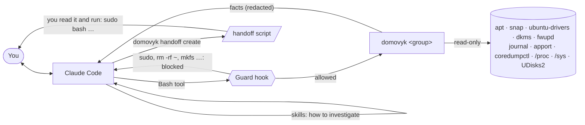

<div align="center">

# Domovyk

**Let Claude look after your Ubuntu machine, safely.**

Drivers · updates · crashes · logs · performance · disk space

[](https://github.com/digitwolf/domovyk/actions/workflows/ci.yml)
[](LICENSE)


</div>

In Ukrainian folklore, the *domovyk* (домовик) is the house spirit who quietly keeps the household in order. This Domovyk does the same for your computer. It gives [Claude Code](https://code.claude.com) what it needs to understand your Ubuntu system and fix it with you:
- clear, read-only facts about the system;
- Ubuntu know-how;
- one safe path for every change.

> **Early development.** These work today:
> - the `domovyk` command, with facts about drivers, logs, performance, services and hardware;
> - the safety guard;
> - the handoff scripts.
>
> Updates, crashes, disk space, the skills and the Claude Code plugin are being built now. See [Status](#status). Stars, issues and pull requests are very welcome.

---

## Why Domovyk?

When something goes wrong on Linux, the answer is usually in the system somewhere:
- a journal entry;
- a driver that `ubuntu-drivers` could install;
- a core dump in `/var/crash`;
- a full journal or forty old snap revisions.

An AI assistant is great at connecting those dots. But today you have two bad choices:

- **Give the agent a shell and hope.** It may run `sudo` commands you didn't read, or delete the wrong thing.
- **Give it nothing.** It guesses from your description and asks you to paste command output back and forth.

Domovyk is the middle path:

| | |
|---|---|
| 🔍 **It sees clearly** | One `domovyk` command reports what is going on: updates, drivers, crashes, logs, performance, disks, services and hardware. Output is short readable text, or stable JSON for the agent. |
| 🧠 **It knows Ubuntu** | Skills teach Claude how an experienced Ubuntu admin works: phased updates, DKMS and Secure Boot, apport crash reports, safe disk cleanup. It works from evidence, not guesses. |
| 🛡️ **It can't break things** | Read commands change nothing. The agent never gets root. A guard blocks `sudo`, `pkexec` and destructive commands such as `rm -rf ~` or `mkfs`, even when hidden inside `bash -c` or `$(...)`. |
| ✍️ **You make every change** | When something needs fixing, Domovyk writes a small script, a *handoff*. You read it and run it yourself with `sudo`. |
| 🤐 **Your secrets stay home** | Tokens, passwords, keys, Wi-Fi passphrases and email addresses are redacted before anything reaches the model. |
| 🧹 **It leaves no trace** | `domovyk unsetup` and `apt purge` remove everything it added. |

## What you can ask

Open Claude through Domovyk and just describe the problem:

| You say | Domovyk does |
|---|---|
| *"My webcam doesn't work."* | Runs `domovyk drivers`. It finds the Intel IPU6 camera with no driver bound and the `intel-ipu6-dkms` package Ubuntu offers for it, then writes a handoff that installs the driver, with a rollback block. |
| *"Why did Firefox crash this morning?"* | Runs `domovyk crash list`, `crash info` and `crash backtrace`. It rules out an out-of-memory kill first, checks what apt changed just before, and tells you what the evidence proves and what is only a guess. |
| *"Why is my laptop so slow?"* | Runs `domovyk perf --sample 5`. It looks at CPU, memory and IO pressure, thermal throttling, the power profile and the top processes, and names the actual bottleneck. |
| *"I'm running out of disk space."* | Runs `domovyk disk`. It ranks what can be reclaimed (journal, old snap revisions, apt cache, old kernels, Docker, trash) by size and risk, and cleans one category at a time, only with your OK. |
| *"It keeps saying restart required."* | Runs `domovyk updates`. It tells you which packages need the reboot and since when, and what else is pending. |
| *"Is anything wrong with this machine?"* | Runs `domovyk doctor`. It lists concrete problems, worst first, each with its evidence and a next step. |

An example session (this is the v0.1 target experience):

```text
$ domovyk agent
> my webcam stopped working after the last update

● domovyk drivers
  Camera: Intel IPU6 (8086:a75d), no driver bound
  Candidate: intel-ipu6-dkms (recommended, not installed)
  Secure Boot: disabled, so no key enrolment is needed

The camera needs the IPU6 driver, which Ubuntu ships as a DKMS package.
Here is the plan:
  1. apt install intel-ipu6-dkms   (builds the module for kernel 7.0.0-43)
  2. reboot, then I check the camera again

● domovyk handoff create --title "Install the Intel IPU6 camera driver"
  ~/.local/state/domovyk/handoff/20261115T210405Z-install-the-intel-ipu6-camera-driver.sh

Read it, then run:  ! sudo bash ~/.local/state/domovyk/handoff/20261115T210405Z-…sh
```

## Status

Domovyk is built in three phases. Phase 1 is under way. It is tracked in a public spec: [requirements](.kiro/specs/domovyk-core/requirements.md), [design](.kiro/specs/domovyk-core/design.md) and [tasks](.kiro/specs/domovyk-core/tasks.md).

| Feature | Status |
|---|---|
| `domovyk` command, `--json` output, `domovyk commands` | ✅ works |
| Handoff scripts: `domovyk handoff create / list / show` | ✅ works |
| Secret redaction on every output | ✅ works |
| Guard against `sudo` and destructive commands | ✅ works (wired into Claude Code with the plugin) |
| Facts: `drivers`, `logs`, `perf`, `services`, `hw` | ✅ works |
| Facts: `updates`, `crash`, `disk` | 🚧 in progress |
| `domovyk status` and `domovyk doctor` | 🚧 in progress |
| Skills: ubuntu, diagnose-crash, drivers, updates, disk, performance | 🚧 in progress |
| Claude Code plugin, `domovyk setup claude`, `domovyk agent` | 🚧 in progress |
| Debian package | 🚧 in progress |
| **Phase 2:** approved changes through a polkit dialog, with undo; crash notifications; a daily checkup | 📅 planned |
| **Phase 3:** Claude Desktop (MCP), other agents, performance history | 📅 planned |

## Install

**You need:** Ubuntu 24.04 LTS or 26.04 LTS (amd64), plus `jq` (`sudo apt install jq`). `bash` and `python3` are already there. For the agent part you also need [Claude Code](https://code.claude.com/docs/en/overview).

### From source (today)

No `sudo` needed. This installs into your home folder:

```bash
git clone https://github.com/digitwolf/domovyk.git
cd domovyk
make install PREFIX="$HOME/.local"
domovyk commands
```

`~/.local/bin` is on your `PATH` by default on Ubuntu. Open a new terminal if `domovyk` is not found yet.

To install for every user instead, run `sudo make install`, which puts it in `/usr/local`.

To remove it: `make uninstall PREFIX="$HOME/.local"`.

### Debian package (coming with v0.1)

```bash
sudo apt install ./domovyk_0.1.0-1_all.deb
```

### Connect it to Claude Code (coming with v0.1)

```bash
domovyk setup claude     # adds the Domovyk plugin to Claude Code, for your user only
domovyk agent            # opens Claude, ready to look after this machine
domovyk unsetup          # disconnects it and removes everything setup added
```

## A quick tour

Every command has `--help`, and every read command has `--json`.

```text
$ domovyk commands
commands               read  List every domovyk command with its tier and summary
drivers                read  Show devices, drivers, ubuntu-drivers candidates, DKMS and Secure Boot
handoff create         user  Write a script for the owner to read and run with sudo (never runs it)
handoff list           read  List handoff scripts, newest first
handoff show           read  Show one handoff script
hw                     read  Show CPU, GPUs and drivers, memory, battery health, firmware and model
logs                   read  Show journal errors, OOM kills, kernel oopses and suspend failures
perf                   read  Show load, memory, pressure, top processes, thermals and power profile
services               read  List failed system and user units with their result and journal tail
services status        read  Show a unit's state, enablement, main PID, memory, restarts and journal
version                read  Show the domovyk version and where it runs from
```

For example, on a small test VM:

```text
$ domovyk perf
load       0.61 0.52 0.27 (1, 5, 15 min), 1/180 running, 4 CPUs
memory     539.4M used of 5.8G (9.1 %), 5.3G available
swap       none
pressure   % of time stalled, avg10 avg60 avg300
  cpu      some 0.20 0.49 0.36   full 0.00 0.00 0.00
  memory   some 0.00 0.00 0.00   full 0.00 0.00 0.00
  io       some 0.00 0.00 0.09   full 0.00 0.00 0.08

top cpu (ps: average since each process started)
       PID    UID   CPU%      RSS  COMMAND
     84097      0    3.5    11.9M  sshd-session
…
```

Each command has a **tier**:
- **`read`** commands only look. They change nothing on your system.
- **`user`** commands change only your own home folder.

No Domovyk command runs as root.

```text
$ echo 'apt-get install -y intel-ipu6-dkms' | domovyk handoff create --title "Install the camera driver"
/home/you/.local/state/domovyk/handoff/20261115T210405Z-install-the-camera-driver.sh
! sudo bash /home/you/.local/state/domovyk/handoff/20261115T210405Z-install-the-camera-driver.sh
```

The JSON output has the same envelope everywhere, so tools and agents can rely on it:

```json
{
  "schema": "domovyk.handoff.v1",
  "generated": "2026-11-15T21:04:05Z",
  "host": {"codename": "resolute", "release": "26.04.1", "kernel": "7.0.0-43-generic"},
  "unavailable": [],
  "scripts": [ … ]
}
```

When a tool a command uses is missing, the command still works. It lists the tool under `unavailable` and names the package to install.

## Privacy

- **What reaches the model.** Anything Claude reads becomes part of your conversation with Claude, under your Claude account's terms.
- **Redaction.** Domovyk's read commands redact secrets by default: tokens, API keys, passwords in URLs and config lines, private keys, Wi-Fi passphrases and email addresses. `--raw` turns redaction off for one command and says so.
- **No identifiers.** The JSON never includes your hostname, machine ID or hardware serial numbers.
- **Crash dumps.** Domovyk reads only backtraces from crash dumps, never memory contents. It deletes the temporary copy it makes.
- **No uploads, no telemetry.** Nothing is sent anywhere by Domovyk itself. Crash reports go to Ubuntu or upstream projects only if you explicitly say yes.

## How it works



The full architecture and its rules are in [DESIGN.md](DESIGN.md).

## FAQ

**Can it break my system?**
Not by itself. Read commands change nothing; the test suite checks this by comparing a fingerprint of the whole system before and after. The agent cannot use `sudo`. Every system change is a script you read and run.

**Does it work without Claude?**
Yes. `domovyk` is a normal command-line tool. `domovyk doctor` and `domovyk disk` are handy on their own, and `--json` is easy to script against.

**Does it work with other AI agents?**
The skills are plain Markdown and the CLI is agent-neutral. Claude Code comes first; other agents and Claude Desktop are planned for phase 3.

**Servers? Other desktops? Other distributions?**
The CLI works on Ubuntu servers and any desktop. Only Ubuntu 24.04 and 26.04 LTS are supported and tested, because the facts are Ubuntu-specific: apport, `ubuntu-drivers` and phased updates.

## Contributing

You don't need to be a shell wizard to help:

- **Try it and tell us what happened.** [Open an issue](https://github.com/digitwolf/domovyk/issues/new/choose) with `domovyk version` and the output that looked wrong.
- **Improve a skill.** Skills are plain Markdown in [`share/claude/plugins/domovyk/skills/`](share/claude/plugins/domovyk/skills). If you know a better way to fix a driver or clean a disk on Ubuntu, write it down.
- **Add a doctor check.** Each check is one small `jq` file.
- **Add a command or fix a bug.** Start with the [contributing guide](CONTRIBUTING.md). It explains the layout, the conventions and the test setup.

All testing happens in throwaway virtual machines, never on your own computer. The repo includes a ready-made QEMU/KVM harness (`test/run-all`), and CI runs the suite on every pull request.

Please read the [code of conduct](CODE_OF_CONDUCT.md). Report security issues privately, as described in [SECURITY.md](SECURITY.md).

## Thanks

Domovyk's approach is inspired by how [Omarchy](https://omarchy.org) integrates coding agents into the desktop: one self-documenting command, skills shipped with the system, and events handed to the agent. Domovyk is an independent project. It is not affiliated with or endorsed by Basecamp, Canonical or Anthropic. Ubuntu is a trademark of Canonical Ltd. Claude is a trademark of Anthropic, PBC.

## License

[MIT](LICENSE)
